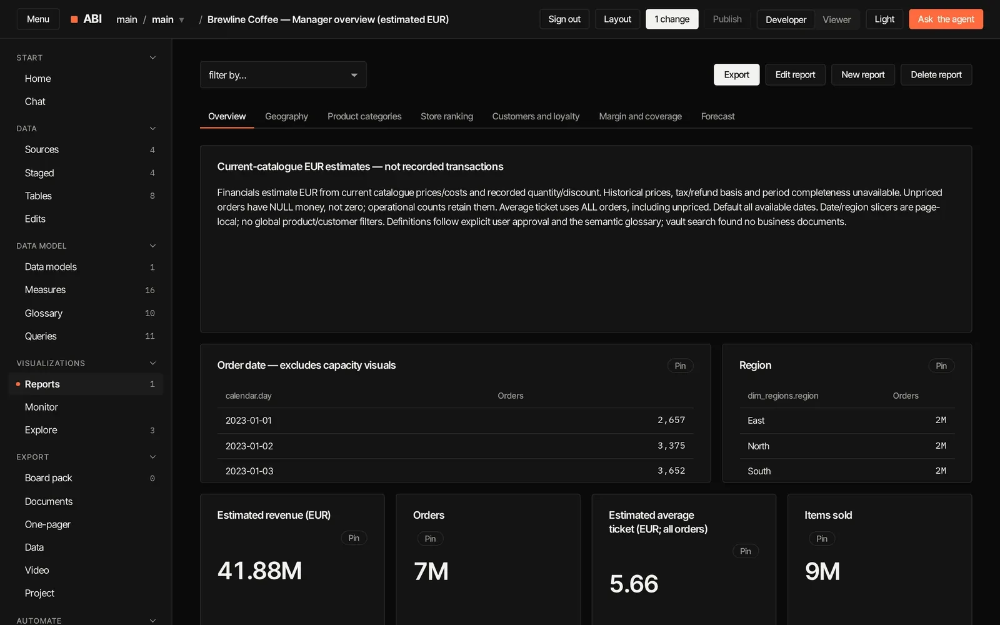
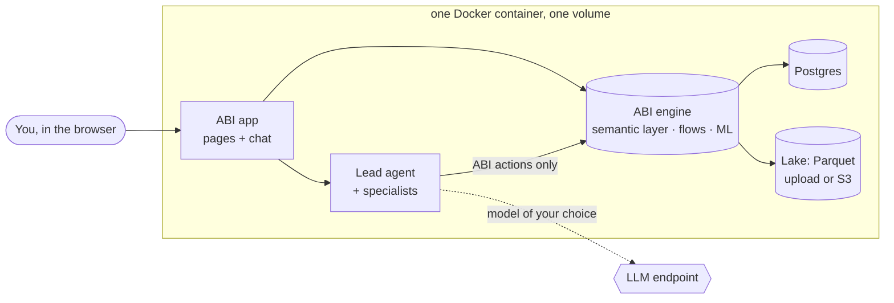

<div align="center">

# ABI

**Agentic BI you host yourself. Describe what you need in plain words; ABI builds the pipeline, the model, the report and the
automation, and every number it tells you comes from a query it actually ran.**


[Website](https://himanshu8881212.github.io/abi-pi/) ([source](website/index.html)) · [Quick start](#quick-start) · [What it does](#what-abi-does) ·
[Contributing](#contributing) · [Release notes](RELEASE.md)

</div>

> [!WARNING]
> **ABI is alpha and under active development.** It works end to end and is tested (see [checks](#how-its-checked)),
> but screens, settings and the data format can still change between versions, and there are known gaps. Run it for
> yourself or your team, keep backups, and expect rough edges. Help shaping it is very welcome: see
> [Contributing](#contributing).



## Why ABI

A typical data team stitches together an ETL tool, a warehouse, a semantic layer, dashboards, alerting, planning
spreadsheets, a scheduler, notebooks and an AI chatbot, then spends its time keeping them in sync. **ABI is all of
it in one container, end to end, out of the box**: from raw data to models, reports, monitoring, write-back,
automated flows and agents.

- **You say it, it builds it.** "Load the orders from S3, clean them, and give me revenue by region per month" turns
  into bronze, silver and gold tables, a semantic model, measures and a report, built step by step in front of you
  through ABI's own actions. Or click it yourself; the screens are the same.
- **Everything as code.** Every source, table, measure, report, flow, agent, tool and security rule is a plain JSON
  file in a Git repository, checked against a schema. Read it, diff it, undo it, publish it, move it between
  environments.
- **Every number has a receipt.** Each figure and name in an answer must appear in a tool result or in your own words.
  Anything the agent can't back up is checked again, then masked as `[not verified]`. No invented totals.
- **It asks before it acts.** Deleting, publishing, sending and syncing wait for your explicit yes in the app. The agent
  never sees the confirmation token and can't approve its own step.
- **It's yours.** One container, one volume, your machine, any model you like: OpenAI, Anthropic, OpenRouter, Gemini,
  Ollama or any OpenAI-compatible endpoint. Your data never leaves except to the model you pick.

## What ABI does

One app, in the order the work happens:

| | |
|---|---|
| **Data** | CSV, Excel, JSON and Parquet files (upload, or an S3 folder of them), Delta and Iceberg tables, Postgres and MySQL tables, into medallion layers: bronze sources, silver cleaned tables, gold facts and dimensions. Sources refresh on change or on a schedule, incrementally where the source allows. |
| **Data model** | Measures, a glossary, saved queries, joins and a calendar, row-level and column security, a model canvas. |
| **Write-back** | Edit rows in the app, or have the agent change a total and let ABI spread it over the rows below; the agent's edits wait for your approval, and every edit undoes in one step. For a table loaded straight from a Postgres or MySQL table (its source added with `"sync": true`, its key the source's primary key), an Owner can have the agent write the edits back to it, after a preview of every change they confirm. |
| **Visualize** | Reports with cross-filtering, drag-and-resize layouts, Explore with saved analyses, Monitor checks (a measure against a value, a target or its last period, freshness, failed flows; measure checks saved there alert in the Inbox, and by email if you like, with no browser open), an Inbox of alerts, flow posts and subscriptions, a Home page of pinned widgets. |
| **Export** | Board packs and one-pagers as PDF, PPTX and PNG, data extracts (Excel, CSV), and short explainer videos (MP4) of a report. |
| **Automate** | Flows on a schedule, a report emailed as a PDF on the days you pick (**Email this report** on its page), ML forecasts, tools, and custom agents with their own evaluation sets, each from a form, from a sentence to the agent, or as JSON. |
| **Knowledge** | A vault for your business definitions; the agent cites it before it defines or judges a measure. |
| **Govern** | Row-level security and hidden columns, roles, Developer and Viewer modes, commits and history, Publish to a read-only copy, model settings. |

The chat sits on every page. Behind it is a lead agent with a team of specialists (data engineer, analytics engineer,
analyst, ML engineer, automation engineer, agent builder, reviewer, release ops, board pack) that it hands work to and
checks.



## Quick start

You need [Docker](https://docs.docker.com/get-docker/) with Compose (Docker Desktop on macOS or Windows), **4 GB of
memory** (8 GB is comfortable), **about 6 GB of free disk** to build, and a model: an API key for OpenAI, Anthropic,
OpenRouter or Gemini, or a local Ollama. It builds on x86-64 and ARM (Apple Silicon).

**1. Get the code**

```sh
git clone https://github.com/Himanshu8881212/abi-pi.git abi
cd abi
```

**2. Create your `.env`** (git-ignored; keep it to yourself)

```sh
cp .env.example .env
```

Set at least the owner account:

```ini
ABI_USER=admin
ABI_PASSWORD=change-me-to-something-long   # 8+ characters; try: openssl rand -hex 16
```

Avoid `$` in values (Compose reads it as a variable), or wrap the value in single quotes.

**3. Start it**

```sh
docker compose up -d --build
```

The first build takes several minutes. The first start sets up the database and creates your owner account; the
container shows `healthy` when it's ready (`docker compose ps`; `docker compose logs -f` to follow along).

**4. Open <http://localhost:8790>** and sign in as `ABI_USER`. Port taken? Set `ABI_PORT=8791` in `.env` and run step 3
again.

**5. Connect a model.** Go to **Govern › Settings**, add a provider (presets for OpenAI, Anthropic, OpenRouter, Ollama
and Gemini, or any OpenAI-compatible URL), paste its key and pick the model. Keys are stored encrypted and never shown
again. Ollama on the same machine is `http://host.docker.internal:11434/v1` (the preset); on Linux, start Ollama with `OLLAMA_HOST=0.0.0.0`.
Tick one or more **fallback** models: when the model is out of quota or down, the chat asks the next one and says so.
**Usage** on the same page shows the tokens per person and model, and the cost of models you give prices (US dollars
per million tokens, on the provider's card); a model without prices counts tokens only.

**6. Bring data.** **Data › Sources › Add source**: upload a CSV, TSV, Excel (.xlsx: name the sheet, or the first is
read), JSON/NDJSON, Parquet or Avro file (any size; it goes up in pieces), or give an S3 location like
`s3://bucket/sales/*.csv` with its region: a glob of any of those formats, or a Delta or Iceberg table's folder (pick
the format). An uploaded CSV loads with standard quoting, so quoted values with line breaks and `""` inside stay one
row (one whose first rows quote with `'` or escape with `\` loads as those rows show); a CSV location is read as
DuckDB guesses from its first rows, so if its quoted line breaks come only further down, upload it, or have the agent
load it with quote and escape set. For a private bucket, add the access key and secret there: they're stored
encrypted, usable only for that bucket's host, and never shown again or given to the agent. MinIO, Cloudflare R2 and
other S3-compatible stores take their host as the endpoint; untick HTTPS for a plain-HTTP one.

**Add a database table** (workspace owners) does the same for a Postgres or MySQL table: host, port, database, schema,
table, the login and, optionally, an increasing column (an ID or an updated-at time). The login is stored encrypted for
that host only, never shown again or given to the agent; the table reloads daily, appending the rows past the
increasing column.

**7. Ask.** Open the chat and say what you need: "Model this data and build me a report of revenue by month and
region."

**8. Add your team.** **Govern › Users & access › Add a person**: a name and a starting password you hand over; they
change it by clicking their name at the top. Then give them a role (Viewer reads, Editor builds) and, if you like,
limit the sections and reports they see. Someone forgot their password? Set a new one for them on the same page.

With a mail server (**Govern › Settings › Email**) you can also invite people by email, "Forgot your password?" on
the sign-in page sends a reset link, and every project without a mail server of its own sends its email through it:
reports, Monitor alerts, flows and the agent's (the first send to a domain asks once per project). With **Settings ›
Single sign-on** people sign in with your company account (Google, Microsoft Entra, Okta, Keycloak: any OpenID
Connect provider); each person links theirs once by clicking their name. Both need `ABI_PUBLIC_URL`, the address
people open, so the links come back to ABI.

### All settings

| Variable | Required | What it does |
|---|---|---|
| `ABI_USER` | yes | The workspace owner, created on the first start. |
| `ABI_PASSWORD` | yes | The owner's password, 8 characters or more. |
| `ABI_PORT` | no | The port on this machine. Default `8790`. |
| `ABI_BIND` | no | The address that port listens on: `127.0.0.1` for this machine only (your own proxy in front). Default: every address; with HTTPS on (below), `127.0.0.1`. |
| `ABI_PROJECT` | no | The project to open first; created if missing. Default `main`. |
| `ABI_WORKSPACE` | no | Its workspace. Default `main`. |
| `ABI_LLM_BASE`, `ABI_LLM_KEY`, `ABI_LLM_MODEL` | no | One OpenAI-compatible model endpoint, its key and the model's id there (e.g. `https://api.openai.com/v1`, `gpt-5`), instead of Settings. |
| `ABI_LLM_API` | no | `openai-completions` (the default with a model) or `openai-responses`. |
| `ABI_PUBLIC_URL` | no | The address people open, e.g. `https://abi.example.com`: emailed links and single sign-on return there. With HTTPS on (below), `https://ABI_DOMAIN` by itself. |
| `ABI_SOURCE_URL` | no | You changed ABI and run it for others: where its source is published. The sign-in page and every page link it (AGPL-3.0 §13). Default: this repository. |
| `COMPOSE_PROFILES`, `ABI_DOMAIN`, `ABI_TLS`, `ABI_TLS_CERT`, `ABI_TLS_KEY`, `ABI_HTTP_PORT`, `ABI_HTTPS_PORT` | no | HTTPS in front of ABI (below). |
| `ABI_SQL_PORT`, `ABI_SQL_BIND`, `ABI_SQL_TLS_CERT`, `ABI_SQL_TLS_KEY` | no | The SQL endpoint for psql, DBeaver and BI tools, off unless `ABI_SQL_PORT` is set (below: Data out). `ABI_SQL_BIND`: the address it is published on, set only with `ABI_SQL_PORT`. Default: as `ABI_BIND`. |
| `ABI_VOLUME` | no | The data volume's name. Default `abi_abi-data`; an install from 1.0 keeps `abi-pi_abi-pi-data` (`scripts/upgrade.sh` sets it). |
| `ABI_IMAGE` | no | The image to run. Default `ghcr.io/himanshu8881212/abi:latest` (pulled with `docker compose pull`, else built here); `ghcr.io/himanshu8881212/abi:latest-video` for explainer videos (below: The two images). |
| `ABI_SECRET_KEY` | no | A Fernet key that encrypts the API keys admins save. Default: a key file in the volume. Make one with `python3 -c "import base64,os;print(base64.urlsafe_b64encode(os.urandom(32)).decode())"`. |
| `ABI_DUCKDB_MEMORY_LIMIT` | no | The memory DuckDB may use for one project's queries and loads in each engine process (the engine and each worker); above it, it spills to disk. Default `1500MB`. |
| `ABI_DUCKDB_THREADS` | no | DuckDB threads for one project's queries and loads in each engine process. Fewer keep other projects' questions quick while one project loads or builds its model; more make one big load or query faster. Default: half the CPUs ABI's process may use (a Docker `--cpus` quota isn't counted: set it then). |
| `ABI_HEAVY_CONCURRENCY` | no | Big loads, query copies and ML trainings run at a time in the heavy worker: `1` or `2` (any other value stops ABI from starting); `2` needs memory for both. Default `1`. |
| `ABI_RUNNER_IDLE` | no | Seconds the heavy queue stays empty before the heavy worker stops and its memory goes back; the next heavy job starts it again within seconds. Default `180`. |
| `ABI_RUNNER_MEMORY`, `ABI_RUNNER_DUCKDB_MEMORY_LIMIT` | no | With the runner profile (below: Heavy jobs and the runner): the runner container's memory limit, default `4g`, and DuckDB's memory per project in it, default `2GB`. |
| `ABI_QUERY_CACHE_MB` | no | Query results kept for reuse, in megabytes per project in each engine process. Default `256`. |
| `ABI_MAX_AGENTS` | no | Chats whose agent runs at once (each a Node process of about 100 MB). One more stops the agent idle longest; with every one busy, the next question waits its turn with a note in its chat. One person runs at most half of them, however many tabs they open. Default `8`. |
| `ABI_QUERY_TIMEOUT` | no | Seconds a question's or a page visual's read may run before it is stopped with a plain error. Default `60`. |
| `ABI_RLS_SHARED_ROWS` | no | People who see only some rows (row-level security) share one read of a fact per data version, grouped by what their rules read, and each gets their own rows from it, filtered as them in the engine. All shared reads kept at once, in every project, hold at most this many rows: one that doesn't fit (or holds more than half the fact's rows) isn't kept, and each person reads on their own for it, as with `0`, until the next data version frees room. Default `1000000`. |
| `ABI_PG_POOL` | no | Postgres connections each engine process keeps open for reuse (`0`: a new one each time). Default `20`. |
| `ABI_INLINE_ROWS` | no | A load (add a source, set a table's steps, reload) of more rows than this answers at once and loads in the background; the Sources page and the chat show its progress. One cut short by a restart fails within about a minute with a note to load it again. Default `4400000` (about 20 s of loading). |
| `ABI_RENDER_TIMEOUT` | no | Seconds a PDF, PNG or PowerPoint export may take before its browser is stopped. Two render at a time; the next waits its turn for this long at most, and a person's second export is refused while their first is drawn. Default `120`. |
| `ABI_VIDEO_TIMEOUT` | no | Seconds a video export may take before it is stopped. Default `900`. |

### Use it from other devices (HTTPS)

ABI's own port serves plain HTTP: fine on this machine or a trusted network (`http://<server>:8790`). For anything
else, turn on HTTPS: [Caddy](https://caddyserver.com) in front with a certificate, and http sent on to https. Add to
`.env`:

```ini
COMPOSE_PROFILES=https       # docker compose (and scripts/upgrade.sh) start Caddy too
ABI_DOMAIN=abi.example.com   # the name or address people open
```

then `docker compose up -d` and open `https://abi.example.com`. ABI's own port then listens on this machine only, so
plain HTTP never reaches the network (`ABI_BIND=0.0.0.0` opens it again). The certificate:

- **A public name** that points at this machine, with ports 80 and 443 open to the internet: Caddy gets one from
  Let's Encrypt and renews it.
- **A LAN name or an IP address**: add `ABI_TLS=internal` for one from Caddy's own authority. Browsers warn until a
  device trusts its root: `docker compose cp https:/data/caddy/pki/authorities/local/root.crt .` and add that file to
  the device's trusted certificates.
- **Your own** (a company authority, an air-gapped network): `ABI_TLS_CERT=/path/fullchain.pem` and
  `ABI_TLS_KEY=/path/key.pem`; after you replace the files, `docker compose restart https`.

`ABI_PUBLIC_URL` becomes `https://ABI_DOMAIN` by itself, so emailed links and single sign-on come back over HTTPS,
unless `.env` already sets one: remove an old `http://` address there, or change it to the https one.
Port 443 or 80 taken? `ABI_HTTPS_PORT=8443`, `ABI_HTTP_PORT=8080` (a public certificate needs one of the two kept).
Your own proxy instead: `ABI_BIND=127.0.0.1`, and have it send `X-Forwarded-Proto: https`.

### Data out: SQL and MCP clients

Other tools read ABI as you, with a **personal token**: click your name, then **Personal tokens**, give it a name
and an expiry (90 days unless you choose; at most 365) and copy it: it is shown only once. The list shows each
token's name, when it was made, last used and expires; **Revoke** ends it at once (a workspace owner sees and can
revoke everyone's). Changing your password ends your tokens too. A token only reads: it signs in as you, row-level
security and column rules hold, and it can't change anything, confirm anything, make tokens or read secrets.

**MCP** (Claude Desktop, Cursor, any client that speaks Streamable HTTP): the address is `https://abi.example.com/mcp`
(or `http://<server>:8790/mcp` on a trusted network) with the header `Authorization: Bearer <token>`. It lists only
reads: `list_projects`, `semantic_model`, `semantic_query`, `visual_data`, `dataset_data`, `list_reports`,
`explain_change`, `how_calculated`, `lineage`, `docs`, `readiness`, `data_quality` and `project_locale`; any other
tool is refused, and every call is in ABI's audit log as you, marked `mcp:token`. The vault (business documents)
isn't offered there: it stays with the app's own agent.

```json
{"mcpServers": {"abi": {"type": "http", "url": "https://abi.example.com/mcp",
                        "headers": {"Authorization": "Bearer abi_pt_..."}}}}
```

**SQL** (psql, DBeaver, Power BI, Tableau, Metabase, Excel through ODBC: anything that speaks Postgres): add
`ABI_SQL_PORT=5433` to `.env` and `docker compose up -d`. A database is a project, the user name your ABI name and
the password your personal token; the tables are the model's, under `public`. Only one read-only `SELECT` at a time,
at most 100,000 rows (more is refused: add a `LIMIT` or filter), 60 seconds each. The port starts only with TLS,
unless it stays on this machine:

- **This machine only**: `ABI_SQL_BIND=127.0.0.1` (the default with HTTPS on): plain connections are fine.
- **Other devices**: a certificate and key, files on this machine readable by the container (uid 10001):
  `ABI_SQL_TLS_CERT=/path/fullchain.pem` and `ABI_SQL_TLS_KEY=/path/key.pem` (with HTTPS on, also `ABI_SQL_BIND=0.0.0.0`). With HTTPS on and your own files for
  Caddy, name the same two files (`ABI_SQL_TLS_CERT=${ABI_TLS_CERT}` and `ABI_SQL_TLS_KEY=${ABI_TLS_KEY}` in `.env`).
  Caddy's automatic certificate (a public name or `ABI_TLS=internal`) lives in its own volume and renews there: give
  the SQL port its own files instead. Clients connect with `sslmode=require`.

Without either, the port stays closed and `docker compose logs abi` says why.

```sh
psql "host=abi.example.com port=5433 dbname=main user=$USER sslmode=require"   # the token at the password prompt
```

In DBeaver: New connection, PostgreSQL, host, port `5433`, database the project, your name and the token as the
password, and on the SSL tab "require". A BI tool's Postgres connector takes the same five things.

### Update

```sh
git pull
scripts/upgrade.sh
```

It backs up the running install to `backups/`, pulls the new image (or builds it here), starts it on the same volume
and waits until it's healthy; Caddy comes along when HTTPS is on (`COMPOSE_PROFILES` in `.env`). An install from 1.0
moves over too: it keeps its volume and its `.env`. The volume remembers its version (`docker exec abi cat
/data/VERSION`) and an older image refuses it: to go back, restore a backup into a new volume (below).

### The two images

| Image | What it holds |
|---|---|
| `abi:latest` (and `abi:<version>`), the default | Everything except video: the engine, Postgres, the agent, the app, and the headless Chrome for PDF, PNG and PowerPoint exports and report emails. |
| `abi:latest-video` (and `abi:<version>-video`) | The default image plus Remotion (`scripts/video/`), for explainer videos (MP4) in the app's Video page and in board packs. |

On the default image, the Video page and a board pack's video item say that video needs the -video image. To switch,
put one line in `.env` and upgrade (`scripts/upgrade.sh` keeps an install on the image it chose, also when it builds
the image here):

```sh
ABI_IMAGE=ghcr.io/himanshu8881212/abi:latest-video
```

Built here: `docker build --target video .` (a plain `docker build .` makes the default image).

**Memory** (measured on 5 Nov 2026, pve1, the default image, no model): an idle container uses about 476 MB, against
1.1.0's 620 MB. The heavy worker runs only while there is work. Each open chat adds about 105 MB (its agent), up to
155 MB for the first chats after a start.

### Heavy jobs and the runner

Big loads, query copies, flow runs with a load, ML or export step, ML trainings and scorings, and the nightly
clean-up are heavy jobs: they wait on the heavy queue and a heavy worker runs them, `ABI_HEAVY_CONCURRENCY` at a time.
That worker runs only while there is work: it starts within seconds of a job being queued and stops after the queue has
been empty `ABI_RUNNER_IDLE` seconds (3 minutes), so the memory a big load took goes back. A check every minute in
the always-on worker finds changed files, daily database reloads and query copies to write, and queues their job.

To give heavy jobs a memory budget of their own, so a load that runs out ends only that load, add to `.env`:

```ini
COMPOSE_PROFILES=runner      # or https,runner
ABI_RUNNER_MEMORY=4g         # the runner container's limit (swap included)
```

then `docker compose up -d`. A second container, `abi-runner`, runs the same image with `ABI_ROLE=runner`: no app,
no engine, no Postgres of its own and no agent, only a shell loop that looks at the heavy queue every 2 seconds and
starts the heavy worker when there is work. It shares the data volume and reaches Postgres through its socket there
(Postgres has no port). While it runs, the main container runs no heavy job. `scripts/backup.sh` pauses it too: a job
it runs finishes first, the next waits for the backup. `docker logs abi-runner` and `/data/logs/runner*.log` show
what it did.

**abi-run.** `abi-run <job id>` runs one queued heavy job to its end and exits: the command a launcher (in 1.3, a
Kubernetes Job) calls. It runs as the person the job is for, as the heavy worker would, and reads what the heavy worker
reads: the engine's Postgres (the job in `procrastinate_jobs`, queue `heavy`) and the data folder. It needs the
image's environment (`ABI_PI_DATA`, by default `/data`, with Postgres's socket in `/data/pg`); in the container:
`docker exec abi abi-run 42`. Exit codes: `0` the job succeeded; `1` it failed, with its error on stderr (the load,
training or flow run says why, as in the app); `2` no heavy job with that id is queued now; `75` a backup holds the
workers: run it again after.

### If something goes wrong

| What you see | What to do |
|---|---|
| `set ABI_PASSWORD in .env` | `.env` is missing or the line is empty: step 2. |
| `port is already allocated` | Set `ABI_PORT` in `.env` (with HTTPS on, also `ABI_HTTP_PORT` and `ABI_HTTPS_PORT`). |
| The chat says nothing for two minutes | The model isn't reachable: check Govern › Settings (the key, the model id, the URL). |
| A file is refused | The message under the form says why; CSV, TSV, Excel, JSON, Parquet and Avro files load (step 6). |
| `ABI isn't answering right now` | The engine is starting, or starting again after it stopped (it does so by itself within seconds): wait a minute. `docker exec abi scripts/engine.sh health` says what isn't serving; `docker exec abi cat /data/logs/supervisor.log` lists every restart. |

## Back up and restore

Everything lives in one volume: the database, the lake, projects, the vault, chats and board packs (with HTTPS on,
Caddy's certificates in a second one: below).

```sh
docker exec abi scripts/backup.sh backup > abi-backup.tar   # database dump + all files, checksummed
docker exec abi scripts/backup.sh keys   > abi-keys.tar     # the two key files: store them somewhere else
```

ABI keeps serving during a backup; queued jobs (scheduled flows, refreshes, trainings) wait until it's done. To
restore into a new, empty volume:

```sh
docker compose down
docker volume rm abi_abi-data          # deletes the current data: only with a checked backup in hand
docker run --rm -i -v abi_abi-data:/data -v "$PWD/abi-keys.tar:/keys.tar:ro" \
  --entrypoint scripts/backup.sh ghcr.io/himanshu8881212/abi:latest restore /keys.tar < abi-backup.tar   # or your ABI_IMAGE
docker compose up -d
```

Without the keys, your data, reports, history and logins come back, but stored source secrets and saved API keys
have to be entered again.

With HTTPS on, Caddy's certificates and keys (with `ABI_TLS=internal`, also the authority your devices trust) live in a
second volume: keep a copy with `docker compose cp https:/data abi-caddy`, and on a new machine put it back after the
first start (`docker compose cp abi-caddy/. https:/data && docker compose restart https`), or every device has to
trust a new authority.

## How it's checked

Every release runs three suites, and their results go into [RELEASE.md](RELEASE.md):

- **Offline tests** (`.venv/bin/python -m pytest -q tests`): the app, the guardrails, the number check, security
  probes and a real browser over every page.
- **Live agent tests** (`ABI_PI_LIVE=1 .venv/bin/python -m pytest -q -m live tests`): the agent driven like a person
  through real scenarios, from a raw file to a model, a report, a flow and a custom agent.
- **Container check** (`tests/container_check.sh`): a fresh volume, loading and querying, PDF, PPTX and video export,
  the agent, a hard kill, a killed engine and worker, a clean `docker stop`, backup and restore, no secrets in the
  image or logs, non-root user, health check.

For 1.0 the whole thing was also run on 7.4 million orders from S3: the agent built the project from eight plain
requests, and its revenue by region matched an independent DuckDB sum to the cent.

### Known limits

- HTTPS (above) gets a public certificate only for a name the internet reaches on port 80 or 443 (no DNS
  challenge); anywhere else the certificate is Caddy's own or yours.
- Email needs a mail server: invitations, password resets and every email a project sends (scheduled reports,
  alerts, flows, the agent's and custom agents' emails) use the one in **Settings › Email**, unless the project has
  its own (which the agent sets); the first send to a domain asks once per project. Until then add people with a
  password, set forgotten ones in Users & access, and read alerts and flow posts in the **Inbox**.
- Monitor's measure checks saved on its page alert with no browser open (ABI checks them every minute, at most once a
  day each); a check from 1.1 or made by the agent does once you click **Alert with the page closed** on its card.
  Freshness and failed-flow checks are evaluated while the page is open, though failed flows and data problems also
  reach the Inbox's alerts. Viewer's published copy has no flows: they run once, in the project.
- A database source copies one whole table (no custom query) and appends the rows past its increasing column each
  day: rows changed or deleted in place at the source stay as loaded until a **Reload** on its card. A Postgres
  `money` column loads as text, a `numeric` without a scale as a float, an enum as its labels. No Snowflake,
  BigQuery, SQL Server or Oracle yet, and no `gs://` or `az://` locations.
- Files already in ABI's files folder on the server (server paths) are the workspace owner's to load; everyone else
  uploads their files.

## Contributing

ABI is early, and that's the best time to shape it. Bug reports, ideas and pull requests are all welcome.

1. **Open an issue** for a bug (what you did, what you expected, what happened) or to discuss a feature before you
   build it.
2. **Run it from source:**

   ```sh
   uv sync && (cd engine/backend && uv sync --frozen --no-dev)
   (cd engine/frontend && npm ci && npx vite build --outDir ../backend/static --emptyOutDir)
   scripts/engine.sh start                                 # Postgres 17 (brew install postgresql@17), engine, workers
   scripts/accounts.py                                     # first run: accounts, passwords in data/accounts.txt
   .venv/bin/python scripts/app.py main 8790 --single      # one person, this machine only
   ```

3. **Keep the rules.** The agent reads data only through ABI's engine, changes projects only through ABI's actions,
   grounds every number, and asks before anything destructive or outward-facing. [AGENTS.md](AGENTS.md) lists them; a
   change that weakens one won't be merged.
4. **Test it.** `.venv/bin/python -m pytest -q tests` must pass (CI runs it on every push and pull request); add a test that fails without your fix.
5. **Small pull requests** with a plain description of what changed and why.

To find your way around the code, `python3 scripts/codegraph.py` writes an Obsidian vault with one note per file.

| Path | What |
|---|---|
| `scripts/app.py` | the app: one server for every workspace and project |
| `engine/` | ABI's engine: semantic layer, actions, flows, ML, custom agents, schemas and UI |
| `.pi/` | the agent: system prompt, extensions (ABI tools, team, confirmations, number check), skills, specialists |
| `harness/` | the team (`team.json`) and the engine's tool groups (`areas.json`) |
| `scripts/` | `abi.py`, `team.py`, `ground.py`, `pack.py`, `video.py`, `transfer.py`, `vault.py`, `backup.sh` |
| `docker/`, `Dockerfile` | the single-container build |
| `tests/` | offline, live and container tests |

### Security

Please don't open a public issue for a vulnerability. Report it privately through GitHub's
[security advisories](https://github.com/Himanshu8881212/abi-pi/security/advisories/new).

## Plans

| | **Community** (self-hosted) | **Enterprise** |
|---|---|---|
| Price | Free, open source (AGPL-3.0) | Contact us |
| Every feature, the agent team, any model | ✓ | ✓ |
| Runs on your own machine | ✓ | ✓ |
| Help with rollout, data sources and security review | | ✓ |
| Support from the people who build ABI | community on GitHub | ✓ |

For Enterprise, [open an enquiry](https://github.com/Himanshu8881212/abi-pi/issues/new?title=Enterprise%20enquiry).

## License

ABI is free software under the [GNU Affero General Public License v3.0](LICENSE). You can use, change and share it;
if you run a changed version as a service for others, you must offer them its source: set `ABI_SOURCE_URL` to where
it is published, and the app's source link (on the sign-in page and every page) points there.

Third-party components keep their own licenses: see [engine/THIRD_PARTY_NOTICES](engine/THIRD_PARTY_NOTICES). The
agent runs on the open-source [Pi coding agent](https://www.npmjs.com/package/@earendil-works/pi-coding-agent). Video
export uses [Remotion](https://www.remotion.dev), which is free for individuals and companies of up to three people;
larger companies need Remotion's company license.
